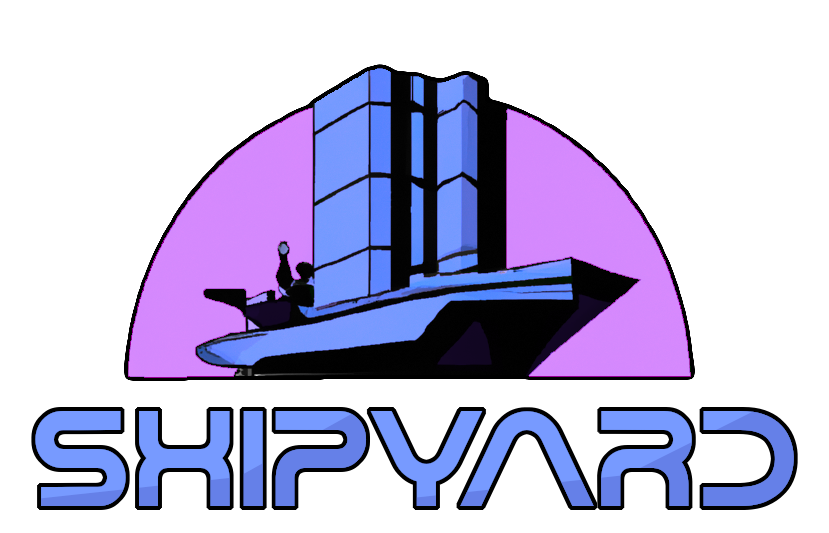

_Containerized builds and patching, driven by declarative Shipfiles._

Shipyard builds generic software and native OS packages inside Dagger
containers. You describe _what_ to build in a `shipfile.py`; Shipyard
handles fetching sources, applying patches, building, testing, and
exporting artifacts.

## Shipfiles

| Base class | Does what |
|---|---|
| `Patcher` | Fetches distro source packages (`apt-get source`, …), applies `@CodePatch` transforms, rebuilds `.deb` / `.rpm` |
| `Builder` | Clones a repo or archive, runs `setup()` / `build()` in a container, exports `save()` artifacts |
| `Tester` | Mixin (`class Shipfile(Patcher, Tester)`) adding `@test` functions that run after every build |

## Quick start

```bash
# check a shipfile is valid
shipyard validate -f shipfile.py

# show versions, metadata
shipyard versions
shipyard info

# generic build in a container (BaseImage comes from the shipfile)
shipyard build

# build a distro package (Debian family shown)
shipyard build --package debian:bookworm openssh

# run tests on extra systems after building (each gets its own section)
shipyard build --test-system ubuntu:24.04 --test-system fedora:38

# work with upstream sources without containers
shipyard pull openssh
shipyard checkout V_9_9_P2
shipyard patch /path/to/tree
shipyard export >> patchfile.diff
```

See [`docs/`](docs/) for the full reference (`Shipfile.md`, `CodePatch.md`,
`Building.md`, `LocalWorkflow.md`) and [`examples/`](examples/) for
runnable Shipfiles.

## Demo

Watch a build with multi-system tests (`demo/showcase.cast`, playable with
[asciinema](https://asciinema.org/), or re-record it with `./demo/showcase.sh`):

```
asciinema play demo/showcase.cast
```

Watch it (24s build + two-system fan-out):

https://github.com/nullmonk/shipyard/blob/develop/demo/showcase.mp4

Re-render from the cast (`demo/render_cast.py` needs `pyte` + `pillow`):

```
python3 demo/render_cast.py demo/showcase.cast demo/frames
ffmpeg -f concat -safe 0 -i demo/frames/concat.txt -c:v libx264 -pix_fmt yuv420p -movflags +faststart demo/showcase.mp4
```

## Install

Requires Go 1.26+ and Docker (Dagger engine):

```bash
make build   # produces bin/shipyard
```
